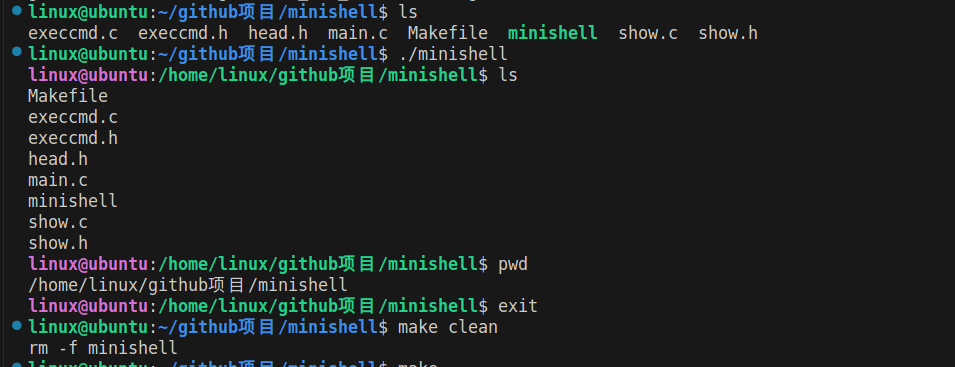

# minishell —— 迷你 Linux Shell

> 用 C 语言 + Linux 系统调用从零实现的交互式 shell，支持 `cd` / `ls` / `cp` / `mv` / `touch` / `mkdir` 等常用命令。
> **所有命令都直接调用系统调用完成，不依赖 `system()`，也不 fork/exec 任何外部可执行程序。**



---

## 一、功能一览

| 命令 | 说明 | 主要系统调用 |
|------|------|--------------|
| `cd [目录]` | 切换目录，缺省回 `$HOME` | `chdir` |
| `pwd` | 打印当前工作目录 | `getcwd` |
| `ls [目录]` | 列出目录内容（跳过隐藏文件，按字典序） | `opendir` / `readdir` / `closedir` |
| `cp <源> <目标>` | 复制文件，目标是目录时自动拷入其下 | `stat` / `open` / `read` / `write` |
| `mv <源> <目标>` | 移动 / 重命名，跨文件系统自动回退 | `rename` / `unlink` |
| `touch <文件>...` | 创建文件或更新时间戳 | `open` / `utimensat` |
| `mkdir <目录>...` | 创建目录 | `mkdir` |
| `rmdir <目录>...` | 删除空目录 | `rmdir` |
| `rm <文件>...` | 删除文件 | `unlink` |
| `cat <文件>...` | 显示文件内容 | `open` / `read` / `write` |
| `echo <参数>...` | 打印参数 | — |
| `help` | 显示帮助 | — |
| `exit` | 退出（也支持 `Ctrl-D`） | — |

---

## 二、项目结构

```
minishell_v1.0/
├── main.c        主循环：打印提示符 → 读入 → 解析 → 分发；持有运行标志 g_running
├── show.c/.h     终端交互：提示符显示 show_cmd_line、读一行 get_usr_cmd、按空白切词 parse_usr_cmd
├── execcmd.c/.h  核心：13 个命令的实现 + 命令表分发 do_usr_cmd
├── head.h        公共头文件，集中包含所需系统调用头
├── Makefile      编译脚本（-Wall -Wextra，零警告）
├── demo1.jpg     演示：ls / ./minishell / ls / pwd / exit
└── demo2.jpg     演示：cat ./main.c
```

源码分工是**一条命令从输入到执行**的流水线：`main.c` 只管循环，`show.c` 只管输入输出，`execcmd.c` 只管命令本身。

---

## 三、整体框架

```
                          ┌───────────────────────────────┐
                          │            main.c             │
                          │    while (g_running) { … }    │
                          └───────────────┬───────────────┘
                                          │
        ┌──────────────────┬──────────────┴───────────────┬──────────────────┐
        ▼                  ▼                              ▼                  │
  show_cmd_line()    get_usr_cmd()               parse_usr_cmd()             │
  打印                fgets 读一行               strtok 按空白切词            │
  "linux@ubuntu:…$"  去掉行尾换行               → cmdarg[]，返回词数 cmdcnt │
        │                  │                              │                  │
        └──────────────────┴──────────────┬───────────────┘                  │
                                          ▼                                  │
                          do_usr_cmd(cmdcnt, cmdarg)  ── execcmd.c          │
                                          │                                  │
                          按 cmdarg[0] 在命令表 g_cmds[] 里查名                 │
                                          │                                  │
      ┌──────────┬──────────┬─────────────┼─────────────┬──────────┬─────────┤
      ▼          ▼          ▼             ▼             ▼          ▼         ▼
   cmd_cd    cmd_ls      cmd_cp       cmd_mv      cmd_touch   cmd_mkdir  ... │
      │          │          │             │             │          │         │
      ▼          ▼          ▼             ▼             ▼          ▼         ▼
   chdir     opendir/    open/read/    rename(2)      open +    mkdir(2)    ...
             readdir     write/stat    /unlink     utimensat
      └──────────┴──────────┴──────┬──────┴─────────────┴──────────┘
                                   ▼
                           Linux 系统调用层
```

要点：**`main.c` 完全不认识任何具体命令**，它只调用 `do_usr_cmd`；命令的"名字 → 函数"的对应关系，全部集中在 `execcmd.c` 的一张表里。

---

## 四、一条命令的执行流程

以 `cp a.txt b.txt` 为例：

```
用户输入  "cp a.txt b.txt"
      │
      ▼
①  fgets 读入整行              →  "cp a.txt b.txt\n"
      │
      ▼
②  去掉行尾换行                →  "cp a.txt b.txt"
      │
      ▼
③  strtok 按空白切词           →  cmdarg = {"cp", "a.txt", "b.txt"}
                                    cmdcnt = 3
      │
      ▼
④  do_usr_cmd 拿 cmdarg[0]="cp" 在命令表里逐个查名
      │
      │     命中 { "cp", "cp <src> <dst> ...", cmd_cp }
      ▼
⑤  通过函数指针调用            →  cmd_cp(3, cmdarg)
      │
      ▼
⑥  命令内部调用系统调用        →  stat / open / read / write / fstat
      │
      ▼
⑦  返回，回到主循环，重新打印提示符，等待下一条命令
```

---

## 五、技术栈 / 涉及知识点

**C 语言层面**

- **结构体数组**：命令表 `g_cmds[]` 是 `cmd_entry` 结构体数组，每一项保存 `{命令名, 用法, 函数指针}`。
- **函数指针**：`int (*fn)(int argc, char *argv[])`。所有命令函数签名统一，因此能存进同一张表，运行时按名字查表并"通过指针调用"——这就是**用函数指针表替代一长串 `if/else if`** 的分发模式。
- **哨兵结束标记**：命令表以 `{NULL, NULL, NULL}` 收尾，遍历时靠 `name == NULL` 判断到头，无需额外记录长度。
- **动态数组 + `realloc`**：`ls` 事先不知道目录里有多少项，用容量翻倍（16 → 32 → 64…）的方式动态扩容。
- **`qsort` + 比较回调**：`ls` 用一个 `cmp_str` 函数指针做比较器，把结果按字典序排序。
- **`strdup` 深拷贝**：`readdir` 返回的 `d_name` 缓冲会被下次调用覆盖，必须拷一份再存。
- **`static` 内部链接**：13 个命令函数全部 `static`，只在本文件可见，对外只暴露 `do_usr_cmd` 一个接口，模块边界干净。

**Linux / POSIX 系统调用**

- 目录：`opendir` / `readdir` / `closedir`
- 文件属性：`stat` / `fstat`（`st_mode`、`st_dev`、`st_ino`）
- 文件读写：`open` / `read` / `write` / `close`
- 目录与文件操作：`mkdir` / `rmdir` / `unlink` / `rename`
- 工作目录：`chdir` / `getcwd`
- 时间戳与权限：`utimensat` / `chmod` / `fchmod`
- 错误处理：`errno` + `strerror` / `perror`

**工程细节（面试可讲）**

- **`write_all` 处理"部分写"**：`write` 可能只写入一部分（short write），也可能被信号中断返回 `EINTR`，所以循环重试直到写完。
- **跨文件系统 `mv`**：`rename` 在跨设备时返回 `EXDEV`，此时退化为"复制 + 删源"，且**复制失败时保留源文件**。
- **`cp` 防自毁**：源和目标若为同一文件（`st_dev` 与 `st_ino` 都相同）则拒绝，否则 `O_TRUNC` 会先把源文件清空。
- **统一的错误语义**：每个命令函数成功返回 `0`、失败返回 `-1`，错误信息走 `stderr`。
- **零警告编译**：`gcc -Wall -Wextra -std=gnu11 -D_GNU_SOURCE` 下无任何告警。

---

## 六、编译与运行

环境：Linux（glibc），装有 `gcc` 和 `make`。

```bash
make            # 编译，生成可执行文件 minishell
./minishell     # 运行

# 示例
linux@ubuntu:~$ ./minishell
linux@ubuntu:/home/linux$ ls
linux@ubuntu:/home/linux$ mkdir test && cd test
linux@ubuntu:/home/linux/test$ touch a.txt
linux@ubuntu:/home/linux/test$ cp a.txt b.txt
linux@ubuntu:/home/linux/test$ mv b.txt c.txt
linux@ubuntu:/home/linux/test$ cat c.txt
linux@ubuntu:/home/linux/test$ exit

make clean      # 清理
```

已实现命令：`cd` `pwd` `ls` `cp` `mv` `touch` `mkdir` `rmdir` `rm` `cat` `echo` `help` `exit`。
在 shell 内输入 `help` 可查看用法。

---

## 七、许可

本项目基于 [MIT License](LICENSE) 开源，Copyright (c) 2026 ttt970。
